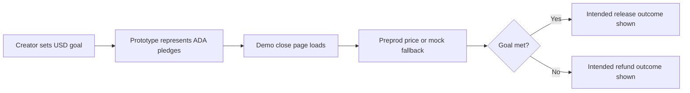

# TSUNAGI Funding

**Connecting People Through ADA Funding**

TSUNAGI Funding is an oracle-native crowdfunding prototype on Cardano.
It models ADA pledges against a USD-denominated goal. When a demo close
page loads, a Charli3 ADA/USD preprod lookup, when available, or labeled
mock data determines a displayed outcome. Real pledges, escrow custody, and release/refund transactions are
not implemented in this prototype.

## Why the oracle matters

Crowdfunding goals are naturally expressed in USD, but supporters pledge in
ADA. The ADA/USD exchange rate moves between the time a campaign launches
and when it closes. Without an oracle, there is no trustworthy way to
determine whether a campaign actually met its USD target.

The oracle supplies the exchange-rate input for a simulated campaign outcome;
it does not move funds. In live mode, TSUNAGI Funding reads the Charli3
ADA/USD preprod feed through Kupo. If live data is unavailable, the app uses
explicitly labeled mock data.

## Current status

This is a hackathon prototype with domain outcome logic, an oracle API route,
and a frontend. It has no CIP-30 pledge transaction flow, escrow contract,
on-chain release/refund transactions, or production campaign persistence.

- **Charli3 ADA/USD integration has been exercised on preprod**
- `/api/oracle` reports the source and status of live or fallback price data
- Domain logic uses the reported price to calculate a simulated outcome
- The frontend is demo-ready but still prototype-stage
- If the live feed is unavailable, the app falls back to mock data with an
  explicit reason shown in the UI

## Historical preprod oracle observation

The live oracle path was exercised against Charli3 preprod data. The following
price is a historical observation, not a current quote:

| Field | Value |
|---|---|
| Status | `live` |
| Price | $0.256299 |
| Raw integer | 256299 |
| Precision | 1e6 (price = raw / 1,000,000) |
| Source | Charli3 ADA/USD preprod (ODV feed) |
| Datum format | Plutus CBOR, decoded from the real on-chain datum |

The recorded datum structure (`Constr → Constr → Map`) came from a
Charli3 ODV preprod contract output. The current UI carries a normalized
price, source and timestamp, not the original raw datum or transaction proof.

## Architecture at a glance



## Prototype flow

1. A creator configures a demo campaign with a USD-denominated goal.
2. The UI represents ADA pledges; it does not submit pledge transactions.
3. When a demo close page loads, the app requests an ADA/USD price and labels preprod data or mock fallback.
4. Domain logic compares `pledged_ada * ada_usd_price` with `goal_usd`.
5. The UI displays the intended release or refund outcome. Wallet transactions, escrow, and fund movement remain future work.

## Routes

| Route | Description |
|---|---|
| `/` | Homepage with campaign cards and product overview |
| `/campaigns/new` | Demo form that redirects to a sample campaign; no persistence |
| `/campaigns/[id]` | Demo campaign detail with pledge panel and reported oracle rate |
| `/campaigns/[id]/close` | Demo outcome page with price/source display; no fund transfer |
| `/demo/oracle-proof` | Interactive oracle demo with source/status and refresh |
| `/api/oracle` | Oracle price API — reports live preprod or labeled mock data (JSON) |

## Local setup

```bash
git clone https://github.com/cryptoleo79/tsunagi-funding.git
cd tsunagi-funding
npm install
cp .env.example .env.local
npm run dev
```

Open http://localhost:3000.

## Environment variables

Configure the oracle connection in `.env.local`:

| Variable | Purpose | Example |
|---|---|---|
| `NEXT_PUBLIC_ORACLE_MODE` | `live` or `mock` | `live` |
| `NEXT_PUBLIC_KUPO_URL` | Kupo indexer endpoint | `http://host:1442` |
| `NEXT_PUBLIC_CHARLI3_ADDRESS` | Charli3 oracle address (preprod) | `addr_test1wq3pacs...` |
| `NEXT_PUBLIC_CHARLI3_POLICY_ID` | Charli3 policy ID | `886dcb2363e160...` |
| `NEXT_PUBLIC_ORACLE_FEED` | Feed name | `ADA/USD` |
| `NEXT_PUBLIC_NETWORK` | Cardano network | `preprod` |

When mode is `mock` or env vars are missing, the app uses demo prices and
labels them clearly. When live mode is configured but the feed is
unreachable, the app falls back with an explicit reason.

## For judges

To verify the oracle integration:

1. **`/api/oracle`** — inspect the JSON `status` and source. A configured,
   available preprod feed can report `"status": "live"`; otherwise inspect the
   labeled mock fallback and its reason.
2. **`/demo/oracle-proof`** — this page shows the oracle status panel
   at the top. Click "Refresh" to refresh the reported price and source status;
   the linked campaign pages calculate example outcomes from demo values.
3. **`/campaigns/demo-1`** — a demo campaign showing the reported ADA/USD rate in the
   pledge panel.
4. **`/campaigns/demo-1/close`** — the outcome page calculates whether the demo goal
   was met; it does not release or refund ADA.

### Quick verification

From the terminal, with the dev server running:

```bash
curl http://localhost:3000/api/oracle
```

With a configured and reachable preprod feed, the response can include
`"status": "live"` and a Charli3 preprod source/slot. Otherwise it reports
mock data with a fallback reason. Neither response executes a settlement.

The oracle layer lives in `lib/oracle/`. The datum decoder in `decode.ts`
handles real Plutus CBOR from the Charli3 ODV contract.

## Hackathon scope

### Pre-existing background
TSUNAGI Funding uses the TSUNAGI name and concept of connection, but this repository is separate from the TSUNAGI node project.

### New work built for this hackathon
This repository contains a hackathon prototype for oracle-informed crowdfunding on Cardano: demo campaign pages, simulated outcome UI, an oracle API route, and a preprod Charli3 ADA/USD lookup with mock fallback. Its campaign stories, supporter counts, pledge amounts, and outcomes are demo data.

## Oracle integration

See [docs/oracle-notes.md](docs/oracle-notes.md) for the full integration
path.

The oracle layer in `lib/oracle/`:

| File | Role |
|---|---|
| `config.ts` | Reads env vars, determines oracle mode |
| `types.ts` | OraclePrice, OracleResult, Kupo response types |
| `decode.ts` | Minimal Plutus CBOR decoder for datum extraction |
| `charli3.ts` | Kupo fetch, datum decode, price extraction |
| `client.ts` | Mode switching (live/mock) with graceful fallback |
| `mock.ts` | Static demo prices |
| `settlement.ts` | Bridges oracle output into simulated domain outcome logic |

## Next steps

1. Add CIP-30 wallet connection for pledge transactions
2. Build escrow smart contract for holding and releasing pledged ADA
3. Persist campaigns to a database or on-chain state
